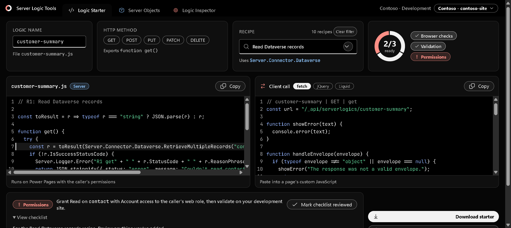
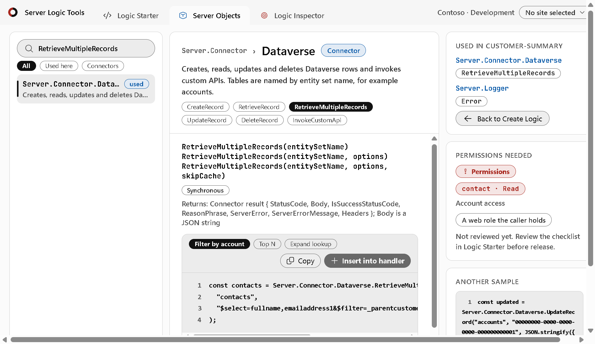

# Server Logic Tools

Generate Power Pages server logic starters, browse the `Server.*` reference, and check a site's server logic readiness in Power Platform ToolBox (PPTB).

## What you can do

- **Logic Starter** generates a server handler, a matching client call, and a permission checklist from one of ten recipes. Edit the handler, review browser-check findings, and download the starter as a ZIP.
- **Server Objects** provides a searchable, curated reference with member signatures, samples, and permission notes. Copy a sample or insert it into the current Starter handler.
- **Logic Inspector** scans the server logic files on a Power Pages site and shows, for each file, whether its web role, table permissions, and outbound networking look configured. Export the results as a Markdown or PDF report.

## Screenshots





## What this tool changes

Starter generation and the object catalogue work without an environment connection. The Inspector needs one active PPTB connection to read a site. None of these features deploy code, configure permissions, or write to your environment. You add the exported files to your Power Pages site and test them there.

## Documentation

The full user guide is at [docs/usage-manual.md](https://github.com/RyanMakesAndBreaksStuff/PowerPage-ServerLogic/blob/main/docs/usage-manual.md):

| You want to | Start here |
| --- | --- |
| Follow a step-by-step lesson | [Tutorial: create your first starter](https://github.com/RyanMakesAndBreaksStuff/PowerPage-ServerLogic/blob/main/docs/tutorials/create-your-first-starter.md) |
| Accomplish a specific task | [How-to guides](https://github.com/RyanMakesAndBreaksStuff/PowerPage-ServerLogic/blob/main/docs/usage-manual.md#how-to-guides) |
| Look up a fact or setting | [Reference](https://github.com/RyanMakesAndBreaksStuff/PowerPage-ServerLogic/blob/main/docs/usage-manual.md#reference) |
| Understand the background | [Explanation](https://github.com/RyanMakesAndBreaksStuff/PowerPage-ServerLogic/blob/main/docs/usage-manual.md#explanation) |

## Requirements

- PPTB Desktop with host API **1.2.7 or later**, as declared in the tool manifest. The PPTB VS Code extension has not been validated for this tool.
- For Logic Inspector: one active PPTB connection to an environment with an enhanced data model Power Pages site. The Logic Starter and Server Objects pages need no connection.
- A Power Pages site with server logic authoring available when you are ready to deploy an exported starter.
- The web roles, table permissions, site settings, and external services required by your selected recipe. The exported `permission-checklist.md` lists these requirements.

Node.js is needed to build this repository; it is not required just to use the tool in PPTB.

## Create your first starter

1. Open **Logic Starter**. The initial recipe is **Read Dataverse records**, with the name `customer-summary`, method **GET**, and a **fetch** client.
2. Choose a recipe, enter a logic name, and select an enabled HTTP method and client language.
3. Adapt the server handler. Review its browser checks and expand **View checklist** to review the permissions and setup requirements.
4. Choose **Download starter** and save the ZIP.
5. Extract it and follow its `README.md` to add the handler and client to your site.

The [tutorial](https://github.com/RyanMakesAndBreaksStuff/PowerPage-ServerLogic/blob/main/docs/tutorials/create-your-first-starter.md) walks through this in detail.

## Build from source

Run these commands from the repository root:

```sh
npm ci
npm run build
npm test
```

The build includes all three pages and writes its output to `dist/`. See [Build and load from source](https://github.com/RyanMakesAndBreaksStuff/PowerPage-ServerLogic/blob/main/docs/how-to/build-and-load-from-source.md) for the required Node.js version, additional checks, packaging, and PPTB loading instructions.

## Contributing

See [CONTRIBUTING.md](https://github.com/RyanMakesAndBreaksStuff/PowerPage-ServerLogic/blob/main/CONTRIBUTING.md). The [changelog](https://github.com/RyanMakesAndBreaksStuff/PowerPage-ServerLogic/blob/main/CHANGELOG.md) records notable changes.

## AI Assistance

Claude Code helped write a portion of this tool. Claude primarily designed a series of probes and scripts to valdiate certain features were even possible. The maintainer reviewed and tested the code and is responsible for its ongoing maintenance.

## License

[BSD 3-Clause](https://github.com/RyanMakesAndBreaksStuff/PowerPage-ServerLogic/blob/main/LICENSE).
