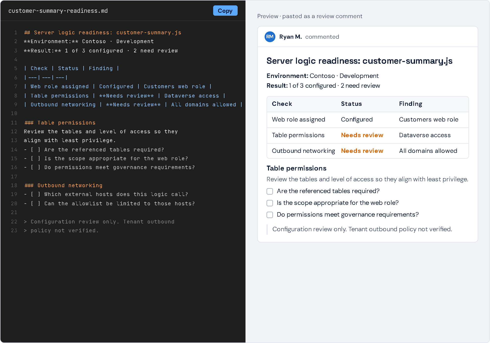
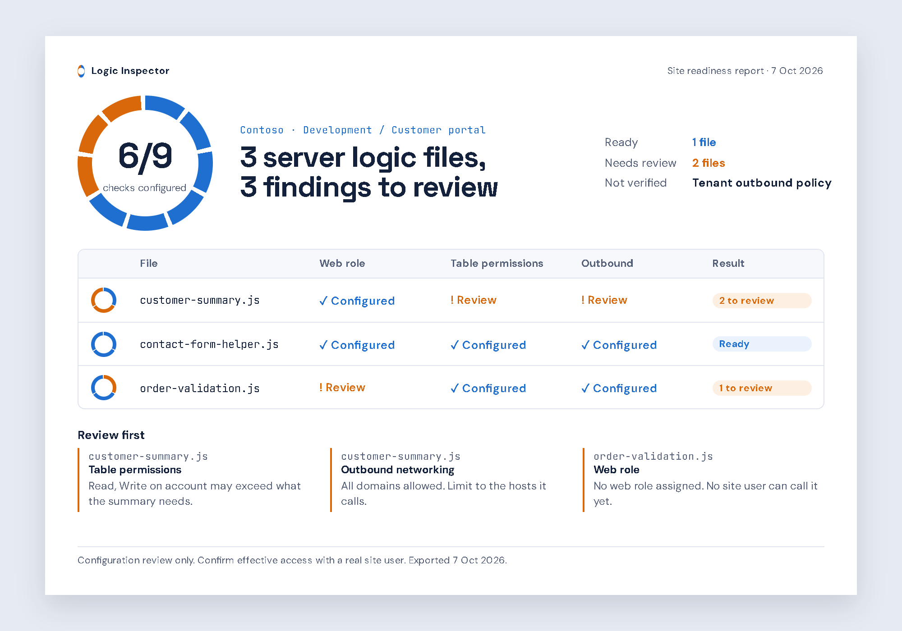

# Handoff: Power Pages Server Logic Tools

## Overview
This is a desktop developer tool for **Power Pages server logic**, with two tools in one window:

- **Logic Starter** gets you from an idea to a working server handler. You choose a logic name, an HTTP method and a recipe. The tool generates the handler JavaScript, a sample client call and a permission checklist, and lets you browse a reference of the `Server.*` objects.
- **Logic Inspector** reviews a site's existing server logic before release. For each file it checks the web role, the table permissions and outbound networking, then exports a readiness report as Markdown or PDF.

The audience is Power Pages makers and pro developers working on a development site.

## About the design files
The files in `reference/` are **design references created in HTML**. They are prototypes that show the intended look and behaviour, not production code to copy. The task is to **recreate these designs in the target codebase's environment** using its established patterns and libraries. If no environment exists yet, choose a suitable framework; the window chrome suggests a WinUI 3 / Fluent desktop shell, or a React + Fluent UI v9 web app.

References 01–05 are static HTML with inline styles: open them directly in a browser. Reference 06 is a clickable prototype of an **earlier layout**. Use it for behaviour (state, toggles, export dialog), not visuals. To run it, open it from the same folder as `support.js`.

## Fidelity
**High-fidelity.** The colours, type, spacing, radii and copy are final. Recreate them precisely, mapping to the codebase's components where an equivalent exists, such as Fluent `TabList`, `Badge`, `Button` and `Dialog`.

## Standing product rules
- **HTTP methods:** always show all five: `GET`, `POST`, `PUT`, `PATCH`, `DELETE`.
- **Report exports:** locked to **Markdown + PDF**, for two scopes, **This file** and **Site summary**. There is no JSON export.
- **Handler code:** uses Power Pages `Server.*` objects. The endpoint is `/_api/serverlogics/<name>`.
- **Readiness colours:** blue `#5aa9ff` means configured or OK, and orange `#ffa24a` means needs review. The **segmented progress ring** is the main readiness visual everywhere.
- **Limits of the review:** the Inspector reviews configuration only. Every report and the Inspector must say so, and that the tenant outbound policy is **not verified**.

---

## Screens / Views

### App shell (shared by Starter and Inspector)
- **Window:** 1100×780 (reference size). Background `#202020`, border `1px #404040`, radius 8px.
- **Title bar:** 42px tall. Left to right:
  - The app glyph: a 16px ring with a conic gradient (blue 0–200°, orange 200–360°) and an 8px hole.
  - The title "Server Logic Tools", 12px.
  - The top-level tabs **Logic Starter** (`{ }` in blue) and **Logic Inspector** (`◎` in orange).
  - Window caption buttons on the right.
- **Active top tab:** background `#282828`, radius 8px 8px 0 0, height 32px, padding 0 16px, 12.5px text. Inactive tabs have no background and text `#9a9a9a`.
- **Sub-tab row** (Starter only), padding 10px 16px 0 on `#282828`:
  - Two pill tabs, **Create Logic** (`✎`) and **Server Objects** (`◇`).
  - Active pill: background `#ffffff`, text `#151515`, weight 600. Inactive pill: `1px #3c3c3c` border, text `#c5c5c5`, with a coloured icon (blue for Create Logic, purple `#c4a7ff` for Server Objects).
  - Pill padding 6px 16px, radius 99px, 13px text.
  - The right side reads "Contoso · Development" followed by a `customer-portal` pill.
- **Content area:** background `#282828`, padding 12px 16px 16px. Tiles sit on a CSS grid with a 12px gap.
- **Tile:** background `#2d2d2d`, border `1px #3c3c3c`, radius 10px, padding 14px 16px.
- **Tile caption:** 11.5px, weight 600, uppercase, letter-spacing .04em, colour `#9a9a9a`.

### 01 · Logic Starter › Create Logic (`reference/01-…`)
**Purpose:** configure a handler and see the generated server code and client call side by side.

**Grid:** 4 equal columns (`repeat(4, minmax(0,1fr))`). Rows are `auto / minmax(0,1fr) / auto`.

**Row 1** (four tiles):
1. **Logic name**
   - Text input: background `#262626`, border `1px #3c3c3c`, bottom border `2px #5aa9ff`, radius 4px, padding 6px 10px.
   - JetBrains Mono 12.5px, value `customer-summary`.
   - Helper line: "File `customer-summary.js`".
2. **HTTP method**
   - A row of pills: `GET` `POST` `PUT` `PATCH` `DELETE`.
   - Selected pill: background `#5aa9ff`, text `#0a1a2e`, bold.
   - Other pills: `1px #3c3c3c` border, text `#c5c5c5`.
   - Helper line: "Exports `function get()`" (the function name follows the method).
3. **Recipe**
   - Pills: *Read Dataverse records* (selected, soft style), *Validate a request*, *Call an external API*.
   - Soft pill style: background `rgba(90,169,255,.16)`, text `#8fc8ff`, border `rgba(90,169,255,.45)`.
4. **Readiness**
   - A 78px segmented ring, 10px thick, showing **2/3** with the caption "ready".
   - Beside it, three stacked pills:
     - `✓ Browser checks` (soft)
     - `✓ Validation` (soft)
     - `! Permissions` (warn style: background `rgba(255,162,74,.15)`, text `#ffa24a`, border `rgba(255,162,74,.5)`, bold)

**Row 2** (spans all 4 columns): a vertical stack, 12px gap.
- **Request path strip** (one tile, full width, padding 10.5px 16px). Five steps separated by `→` (colour `#9a9a9a`). Each step has a 10.5px uppercase label above a mono 11px pill:
  1. Page script → `fetch()`
  2. Token → `__RequestVerificationToken`
  3. Endpoint → `/_api/serverlogics/customer-summary` (soft pill)
  4. Handler → `function get()` (warn pill)
  5. Returns → `JSON string`

  Flex weights are 1 / 1.4 / 1.8 / 1 / 1. Pills truncate with an ellipsis.
- **Two code panes**, side by side (2 equal columns, 12px gap). Each pane:
  - A 40px header with a `1px #3c3c3c` bottom border and a **Copy** pill button on the right (background `#373737`).
  - A code body: background `#262626`, padding 12px, JetBrains Mono 10.5px, line-height 1.72, 3ch right-aligned line numbers in `#5f5f5f`.
  - A footer line: 11.5px, `#9a9a9a`.

  The panes:
  - **Server pane**
    - Header: `customer-summary.js` plus a purple `Server` pill.
    - Lines 4–7 are highlighted: background `rgba(90,169,255,.1)` with a 2px blue inset left bar.
    - Footer: "Runs on Power Pages with the caller's permissions".
  - **Client call pane**
    - Header: orange `⇄` "Client call" plus the pills `fetch` (selected), `jQuery`, `Liquid`.
    - Lines 3 and 6 are highlighted.
    - Footer: "Paste into a page's custom JavaScript".

**Row 3:**
- **Note tile** (columns 1–3): a `! Permissions` warn pill, then "Grant Read on `contact` to the caller's web role, then validate on your development site."
- **Primary button** (column 4): **Download starter ↓**. Pill radius 99px, background `#5aa9ff`, text `#0a1a2e`, 14px bold, padding 12px 20px.

**Generated code** (exact text, from the reference):
```js
// customer-summary.js · handles GET
function get() {
  try {
    Server.Logger.Log("customer-summary called");
    const result = Server.Connector.Dataverse
      .RetrieveMultipleRecords("contacts",
        "?$select=fullname,emailaddress1&$top=10");
    return result;
  } catch (err) {
    Server.Logger.Error(err.message);
    return JSON.stringify({ error: err.message });
  }
}
```
```js
// Call from a page or web template
shell.getTokenDeferred().done(function (token) {
  fetch("/_api/serverlogics/customer-summary", {
    method: "GET",
    headers: {
      "__RequestVerificationToken": token,
      "Content-Type": "application/json"
    }
  })
  .then(function (res) { return res.json(); })
  .then(function (data) { console.log(data); })
  .catch(function (err) { console.error(err); });
});
```
**Syntax colours:**
- Keywords: `#ffa24a`
- Strings: `#8fc8ff`
- Comments: `#858585`
- `Server.*` objects: `#c4a7ff`
- Default text: `#e8e8e8`

> ⚠ **Check the API details against Microsoft Learn before shipping.** These are the method names, the `shell.getTokenDeferred()` token pattern, and the `Server.*` member lists. Sources: "Author server logic" and "Server objects" on learn.microsoft.com/power-pages.

### 02 · Logic Starter › Server Objects (`reference/02-…`)
**Purpose:** a full-page reference of the `Server.*` objects, with samples you can insert into the handler.

**Grid:** `260px / minmax(0,1fr) / 250px` columns, 12px gap.

**Left column: object list** (one tile, padding 12px)
- **Search field:** pill shape, background `#262626`, border `1px #3c3c3c`, placeholder "⌕ Search objects and methods".
- **Filter pills:** **All** (selected), Used here, Connectors.
- **Rows:** padding 8px 10px, radius 8px. Each row shows the object name in mono 12px, then the description and method count in 11.5px `#9a9a9a`.
  - The selected row has background `rgba(255,255,255,.06)`, a 3px blue left bar inset 11px top and bottom, and the name in `#8fc8ff`.
  - Objects used by the current handler get a small purple `used` pill.
- **Objects (8):**
  - `Server.Logger`: Log, Warning, Error
  - `Server.Context`: QueryParameters, Headers, Body, HttpMethod, Url
  - `Server.User`: fullname, contactid, Roles
  - `Server.Connector.Dataverse`: CreateRecord, RetrieveRecord, RetrieveMultipleRecords, UpdateRecord, DeleteRecord, InvokeCustomApi
  - `Server.Connector.HttpClient`: GetAsync, PostAsync, PutAsync, PatchAsync, DeleteAsync
  - `Server.Website`: adx_websiteid, name
  - `Server.Sitesetting`: Get
  - `Server.EnvironmentVariable`: get

**Centre column: object detail** (one tile, padding 0)
- **Header** (padding 18px 20px 14px, bottom border):
  - Breadcrumb `Server.Connector` › **Dataverse** (20px, weight 600), followed by a purple `Connector` pill.
  - A 13px description in `#c5c5c5`.
  - Method pills below. The selected method uses the solid blue pill; a related method uses the soft pill.
- **Body** (padding 14px 20px):
  - **Method signature:** `RetrieveMultipleRecords` in mono 14px `#8fc8ff`, then `(entitySetName, options)` in `#9a9a9a`. "Returns JSON string" is right-aligned.
  - **Sample card:** background `#262626`, radius 10px.
    - Toolbar: variant pills *Filter by account* (soft), *Top N* and *Expand lookup*. On the right, a **Copy** button and an **Insert into handler** button (primary pill).
    - Code: mono 11.5px.
  - **"All methods" table:** columns 190px / 210px / 1fr for name, signature and description, with rows 7px 12px. The selected method's row is tinted `rgba(90,169,255,.08)`.

**Right column** (three stacked tiles)
1. **Used in customer-summary:** each object used, with pills for the methods called. Then a link "← Back to Create Logic" in `#5aa9ff`.
2. **Permissions needed:** "Read on `contact` for the caller's web role." Pills `contact · Read` (warn) and `Customers role` (soft). Then "Not set up yet. Add a table permission before release."
3. **Another sample:** a short `RetrieveRecord` sample in mono 10px, wrapped to fit the 250px column, followed by a `RetrieveRecord` pill.

### 03 · Logic Inspector, glass bento (`reference/03-…`, mock 4a)
**Purpose:** review readiness for one server logic file.

> This screen uses the **glass** visual treatment. Inside the shared app shell, put the glass styling on the tiles only and keep the shell chrome above. The client should confirm whether the window background takes the aurora gradient or stays `#282828`.

**Background:** `#081022` with three radial gradients:
- `rgba(90,169,255,.45)` at 8% 5%
- `rgba(255,162,74,.38)` at 95% 95%
- `rgba(60,90,200,.4)` at 70% 10%

**Tile:**
- Background `rgba(255,255,255,.07)`, border `1px rgba(255,255,255,.16)`, `backdrop-filter: blur(16px)`, radius 18px, padding 18px.
- Shadow: `inset 0 1px 0 rgba(255,255,255,.14), 0 10px 30px rgba(0,0,0,.25)`.

**Colours:** text `#eef4ff`, muted `#9fb3d6`.

**Grid:** `200px 1.15fr 1fr 1fr` columns, `auto 1fr 1fr` rows, 14px gap.
- **Files tile** (column 1, all rows)
  - The "Server logic (3)" list. The selected file has background `rgba(90,169,255,.18)` and border `rgba(90,169,255,.5)`.
  - The tenant-policy warning sits at the bottom, with its title in orange.
- **Title tile** (columns 2–4)
  - A mono 12px blue line: `customer-summary.js · Active`.
  - "Review server logic readiness" in 34px, weight 700, letter-spacing -.03em.
  - A sub-line.
- **Ring tile** (column 2, rows 2–3)
  - A 200px ring, 22px thick. Gaps between segments are `rgba(255,255,255,.05)`; the hole is solid `#0d1730`.
  - It shows **1/3** with the caption "configured".
  - Legend below: "1 OK" and "2 review".
- **Finding tiles** (×3)
  - Each has a 30px icon square: radius 10px, background at 15% of the status colour, with ✓ or !.
  - Then a 15px title, a 12.5px description, and the status pinned to the bottom.
  - The selected finding ("Table permissions") has border `rgba(255,162,74,.6)` and background `rgba(255,162,74,.1)`.
- **Detail tile:** the title, a guidance line, and the "Questions to consider" list.
- **Header actions:** "Contoso · Dev", "Customer portal", and **Export report**. Export report is a pill with a 90° gradient from `#5aa9ff` to `#8fc6ff` and text `#06122b`.

**Findings content** (from the prototype data):

| File | Web role | Table permissions | Outbound |
|---|---|---|---|
| customer-summary.js | ✓ Customers | ! contact (Read), account (Read, Write) | ! All domains |
| contact-form-helper.js | ✓ Authenticated users | ✓ contact (Create) | ✓ None |
| order-validation.js | ! None assigned | ✓ salesorder (Read) | ✓ api.contoso-erp.com |

### 04 · Report: This file (`reference/04-…`, mock 7f)


**Two formats:**
- **Markdown:** the left pane of the reference shows the exact `.md` content.
- **PDF:** the same content laid out using the page styling from reference 05.

**Markdown structure:**
1. H2 "Server logic readiness: <file>".
2. Bold **Environment** and **Result** lines.
3. A table with the columns Check | Status | Finding.
4. One H3 for each finding that needs review, followed by its guidance and a `- [ ]` checklist of questions.
5. A closing blockquote: "Configuration review only. Tenant outbound policy not verified."

**Markdown preview pane:** shows how the report renders when pasted into a PR or work item.
- White card, border `1px #dfe4ee`, radius 8px.
- "Needs review" status text in `#d9680a` bold.
- Checkboxes 13px with a `1px #9aa3b5` border.

**Markdown editor pane:** background `#1e1e1e`, header 42px with a blue **Copy** button.
- Syntax colours: headings `#ffa24a`, table rows `#8fc8ff`, list items `#c5c5c5`, quotes `#858585`.

### 05 · Report: Site summary (`reference/05-…`, mock 7h)


**Two formats:**
- **PDF:** the page shown in the reference, on a 900×620 sheet.
- **Markdown:** the same sections expressed as H2 / table / H3 / checklist, as in 04.

**Page:** white, padding 32px 36px, shadow `0 12px 30px rgba(20,33,61,.14)`. Fonts: DM Sans for body text, Space Grotesk for headings, JetBrains Mono for paths.

**Sections:**
1. **Header row:** the glyph and "Logic Inspector" on the left, "Site readiness report · <date>" on the right.
2. **Hero**
   - A 150px ring, 16px thick, with 9 segments (6 blue, 3 orange). It shows **6/9** with the caption "checks configured".
   - Beside it, the mono path `Contoso · Development / Customer portal` and the headline "3 server logic files, 3 findings to review" in 32px, weight 700.
   - On the right, a key/value grid: Ready 1 file (blue), Needs review 2 files (orange), Not verified: Tenant outbound policy.
3. **Files table**
   - Columns: 44px mini-ring (28px) / File (mono) / Web role / Table permissions / Outbound / Result pill.
   - Header row background `#f6f8fc`, 11.5px bold `#55607a`. Cells read "✓ Configured" in blue or "! Review" in orange.
4. **"Review first":** three columns, one finding each, with a 3px orange left border.
5. **Footer:** "Configuration review only. Confirm effective access with a real site user. Exported <date>."

**Report palette:**
- Ink `#14213d`, muted `#55607a`, rules `#dfe4ee`
- Blue `#1f6fd1`, blue tint `#eaf2fd`
- Orange `#d9680a`, orange tint `#fdf0e3`

**Status chips:** radius 99px, padding 2px 8px, 10.5px bold.

---

## Interactions & Behaviour
Prototype 06 shows the working behaviour, using the earlier layout.

**Top tabs**
- Clicking Logic Starter or Logic Inspector swaps the content area. There is no animation.

**Starter sub-tabs**
- Clicking Create Logic or Server Objects swaps the content area.
- "Browse all in Server Objects" and "← Back to Create Logic" move between the two sub-tabs.

**Create Logic**
- **Logic name:** controlled input. Slugify the value (lowercase, `[^a-z0-9]+` → `-`, trim the dashes). The slug drives the file name, the endpoint and the client-call URL.
- **HTTP method:** single-select across all five methods. The choice changes the handler function name (`get` / `post` / `put` / `patch` / `delete`) and the client `method:`. POST, PUT and PATCH add a `body: JSON.stringify(...)` to the client call.
- **Recipe:** single-select. It regenerates the handler code and resets the permission check to "needs review". The recipe sets the default method: Read → GET, Validate → POST, External → GET.
- **Client call language:** fetch, jQuery or Liquid. It regenerates the code in the client pane.
- **Readiness ring:** has three segments. "Mark checklist reviewed" turns the permissions segment blue (3/3).
- **Copy:** copies the pane's plain text and shows the toast "Code copied". Toasts are centred at the bottom of the window and disappear after 2.6s.
- **Download starter:** produces `<slug>.zip`, containing the handler `.js`, the client snippet, a README and the permission checklist.

**Server Objects**
- **Search:** filters objects and methods by name.
- **Filter pills:** All, Used here and Connectors.
- **Selection:** selecting an object shows its detail; selecting a method pill updates the signature and the sample.
- **Insert into handler:** inserts the sample at the cursor in the server pane and switches to Create Logic.

**Inspector**
- **File list:** selecting a file loads its findings.
- **Default finding:** the first finding that needs review is selected by default.
- **Mark as reviewed:** only shown for "Needs review" findings. It turns the status blue ("Reviewed") and updates the ring, the per-file summary in the list, and the configuration snapshot.

**Export dialog**
- Modal, 520px, on a `rgba(0,0,0,.55)` scrim.
- **Report:** This file or Site summary.
- **Format:** Markdown (the default) or PDF.
- **Include** checkboxes:
  - Questions to consider (on)
  - Configuration snapshot (on)
  - Redact environment and site names (off)
- The primary button reads "Export Markdown" or "Export PDF".
- **File names:**
  - This file: `<file>-readiness.md` or `<file>-readiness.pdf`
  - Site summary: `<site>-site-readiness.md` or `<site>-site-readiness.pdf`

**Pill states**
- Hover: lighten the background by about 6%.
- Focus-visible: 2px `#5aa9ff` outline, 2px offset.
- The selected pill is never shown in orange; orange is reserved for status.

## State
```ts
view: 'starter' | 'inspector'
starterTab: 'create' | 'objects'
name: string; method: 'GET'|'POST'|'PUT'|'PATCH'|'DELETE'
recipe: 'read' | 'validate' | 'external'; clientLang: 'fetch'|'jquery'|'liquid'
permReviewed: boolean
objects: { query: string; filter: 'all'|'used'|'connectors'; selected: string; method: string }
inspector: { fileIndex: number; findingIndex: number|null; reviewed: Record<string, boolean> }
export: { open: boolean; scope: 'file'|'site'; format: 'md'|'pdf'; includeQuestions: boolean; includeConfig: boolean; redact: boolean }
```

**Data needed from the environment:**
- The list of server logic records on the site.
- For each one: the assigned web roles, the table permissions (table and privileges), and the outbound HTTP allowlist.

Tenant outbound policy is **not** read; always show it as "not verified".

## Design tokens
**App: WinUI dark**

| Token | Value |
|---|---|
| window | `#202020` |
| surface | `#282828` |
| tile | `#2d2d2d` |
| input / code | `#262626` |
| border | `#3c3c3c` |
| text | `#ffffff` |
| text-2 | `#c5c5c5` |
| text-3 | `#9a9a9a` |
| line-number | `#5f5f5f` |
| blue / ok | `#5aa9ff` |
| on-blue | `#0a1a2e` |
| blue-soft | `rgba(90,169,255,.16)` with border `rgba(90,169,255,.45)` and text `#8fc8ff` |
| orange / review | `#ffa24a` |
| orange-soft | `rgba(255,162,74,.15)` with border `rgba(255,162,74,.5)` |
| object | `#c4a7ff` (soft: `rgba(196,167,255,.14)` with border `rgba(196,167,255,.45)`) |
| secondary button | `#373737` |

**Radius**
- Window: 8px
- Tile: 10px
- Glass tile: 18px
- Input: 4px
- Pill and pill buttons: 99px

**Spacing:** 4 / 6 / 8 / 10 / 12 / 14 / 16 / 20px. Grid gaps are 12px (14px for glass).

**Type**
- UI: Segoe UI Variable Text and Display, falling back to system-ui.
- Code: JetBrains Mono.
- Sizes: 10.5 / 11.5 / 12 / 12.5 / 13 / 14 / 16 / 20 / 30–34px.
- Weights: 400 / 600 / 700.

**Ring**
- Built as a conic gradient: N equal segments with a 4° gap between them, in the tile colour, and a solid centre hole.
- Sizes: 46–78px in tiles, 150–200px as a hero.
- Implement as SVG arcs in production.

## Assets
None. All icons are text glyphs (`{ } ◎ ✎ ◇ ⇄ ✓ ! ⌕ ↓`); replace them with the codebase's icon set, such as Fluent System Icons. The fonts load from Google Fonts in the references.

## Files
- `reference/01-logic-starter-create-logic.html`: Starter › Create Logic (9a)
- `reference/02-logic-starter-server-objects.html`: Starter › Server Objects (9b)
- `reference/03-logic-inspector-glass-bento.html`: Inspector (4a)
- `reference/04-report-this-file-markdown.html`: report for This file (7f)
- `reference/05-report-site-summary.html`: report for Site summary (7h)
- `reference/06-interactive-prototype.dc.html` + `support.js`: behaviour reference, earlier layout
- `screenshots/04-report-this-file.png`, `screenshots/05-report-site-summary.png`: report visuals, 2000×1400 PNG (2×)
