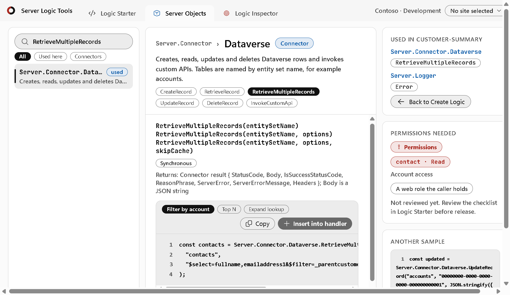

# Browse and insert Server Objects

Search the curated `Server.*` reference in the **Server Objects** page, read a member's signature and samples, and insert a sample into the current Starter handler.

[Back to the user guide](../usage-manual.md) · [Server Objects reference](../reference/server-objects.md)

## Find an object or method

1. Open **Server Objects**, or choose **Browse all** from Starter.
2. Enter an object path or member name in **Search objects and methods**. Matching is case-insensitive and uses substrings.
3. Select a filter to show all objects, objects used in the current handler, or connectors.
4. Select an object and a member to see its signature, return information, execution context or timing, and samples where supplied.
5. Use the sample selector when a member offers multiple examples.

The context column shows **Used in {slug}**, **Permissions needed**, and **Another sample** where available. Used marks come from analysis of the current Starter handler; they are a navigation aid rather than a record of deployed code or runtime calls.

The catalogue is curated data shipped with the tool. It does not discover the APIs available in your connected environment, and a member's detail shows **Returns** only where Microsoft Learn documents a return type. It is the authoritative source; the [reference doc](../reference/server-objects.md) summarises it and may lag behind the app.

## Insert a sample into the handler

1. In Starter, choose the target recipe and method. Place the cursor at a statement boundary inside the intended handler function if you want a specific insertion point.
2. Open **Server Objects** and select a sample.
3. Choose **Insert into handler**.
4. Starter opens with the insertion applied. Review the resulting code, its browser checks, and any new permission or configuration requirements.

When no cursor is available, insertion targets the selected handler function before its last top-level return, or at the end of its body. Insertion can add `async` when a sample needs `await`. It does not configure the environment or reconcile sample variable names with your business logic.

If the tool cannot find a safe insertion location, the control shows a reason. Copying the sample remains available so you can adapt it manually. **Back to Create Logic** returns to Starter without inserting a sample.