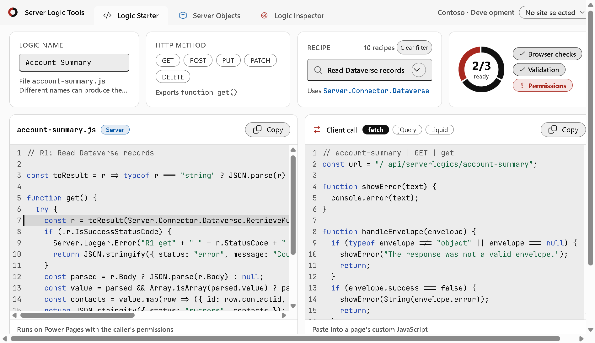
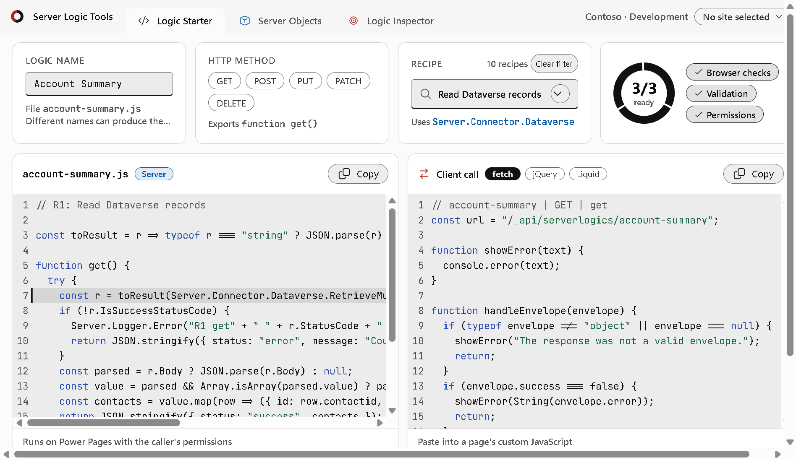

# Generate and adapt a starter

Generate a Power Pages server logic handler, its matching client call, and a permission checklist from one of ten recipes, then download them as a deployable ZIP. This guide assumes you know which outcome you want; for a guided first run, see the [tutorial](../tutorials/create-your-first-starter.md).

[Back to the user guide](../usage-manual.md) · [Recipes reference](../reference/recipes.md)

## Choose a recipe

Open **Logic Starter** and select the pattern closest to your goal from **Recipe**. Each recipe supplies a handler, the HTTP methods it supports, example requests, and setup guidance. The full catalogue — including each recipe's tables, site settings, outbound domains, and web-role requirements — is in the [recipe reference](../reference/recipes.md).

Changing recipes after editing the handler prompts before discarding your edits. Copy or download work you want to keep before accepting that change.

## Set the name, method, and client language

1. Enter a descriptive name in **Logic name**. Starter derives a URL-safe slug for the endpoint and the downloaded files: it lowercases the name, replaces runs of non-ASCII-alphanumeric characters with dashes, trims edge dashes, and limits the result to 64 characters — `untitled` for an empty result, and reserved Windows device names get a `-logic` suffix. Use this slug when you create the server logic record on your site, and check for an existing endpoint before deploying — different names can produce the same slug and Starter does not inspect your site.
2. Select an enabled HTTP method. A method is disabled when the recipe does not export its handler function:

| HTTP method | Handler function |
| --- | --- |
| GET | `get()` |
| POST | `post()` |
| PUT | `put()` |
| PATCH | `patch()` |
| DELETE | `del()` |

3. In **Client call**, choose **fetch**, **jQuery**, or **Liquid** when enabled. HTTP clients call `/_api/serverlogics/{slug}`. The generated code includes request-verification-token handling and the recipe's example request. **Invoke from Liquid** uses the `serverlogic` Liquid tag instead of an endpoint, so its HTTP-method and JavaScript-client choices are disabled.

## Edit and adapt the handler

Edit the **Server** pane directly, replacing sample identifiers, settings, service addresses, and business rules with your own values. The client pane is generated and read-only; it updates from the name, recipe, method, and language, and does not infer a new contract from arbitrary handler edits. Use **Copy server code** for the handler and **Copy client call** for the client, then adapt the client's example values in your page code.

You can pull API samples out of the catalogue and into the handler; see [Browse and insert Server Objects](browse-and-insert-server-objects.md).

## Review readiness and permissions

The **Readiness** count combines three indicators:

| Indicator | What it means |
| --- | --- |
| **Browser checks** | No restricted-pattern hits or parse failure were found in the current handler. A code-pattern check, not compilation or a runtime test. Findings can be labelled **Blocked** or **May be rejected**. |
| **Validation** | The starter provides generated validation scaffolding. This indicator stays complete; it does not revalidate your edited business logic. |
| **Permissions** | You marked the checklist reviewed for the exact current handler text. The tool has not checked the site's actual configuration. |

To review permissions:

1. Read the permission note below the code panes.
2. Expand **View checklist**.
3. Review the recipe's roles, table permissions, site settings, outbound hosts, and prerequisites. Include any additional requirements your edits or inserted samples introduce.
4. Choose **Mark checklist reviewed** to record your review for the current code.
5. Use **Undo review** to clear that acknowledgment when needed.

Changing the handler text makes a previous review no longer apply unless the text again matches the reviewed version. A count of **3/3 ready** does not confirm authorization, deployment, or successful execution. Download remains available when items need attention, and the package records that state. See [How readiness is determined](../explanation/how-readiness-is-determined.md) for the full picture.

## Download and use the package

1. Choose **Download starter**.
2. Select a location in the PPTB save dialog and save `{slug}.zip`. Cancelling leaves the session available for further editing.

The save dialog itself is provided by PPTB: choose a folder to save `{slug}.zip`, or cancel to leave the session intact with nothing saved.

Extract the archive and open its `README.md`:

| File | Purpose |
| --- | --- |
| `{slug}.js` | Your current server handler, including edits and inserted samples. |
| `{slug}.client.js` | Generated fetch or jQuery client call. |
| `{slug}.client.liquid` | Generated Liquid client, used instead of the JavaScript client when Liquid is selected. |
| `README.md` | Recipe-specific setup, endpoint or Liquid invocation, request path, checks, prerequisites, and troubleshooting. |
| `permission-checklist.md` | Recipe configuration checklist and readiness information. Review extra requirements from custom edits separately. |
| `{slug}.page.html` | Reference demo page for Dataverse CRUD, External service CRUD, or Call an Azure Function. Other recipes omit this file. |

To add the files to Power Pages, follow the generated README. Its setup sequence is to create the server logic record named as the exported slug, add the listed web role, replace the handler's content with `{slug}.js`, configure the settings, allowed domains, and table permissions from `permission-checklist.md`, and paste the client into the page or web template. Test on your configured site using the intended caller role; see the [tutorial](../tutorials/create-your-first-starter.md#step-7--download-and-deploy-the-starter) for the full eight-step sequence.