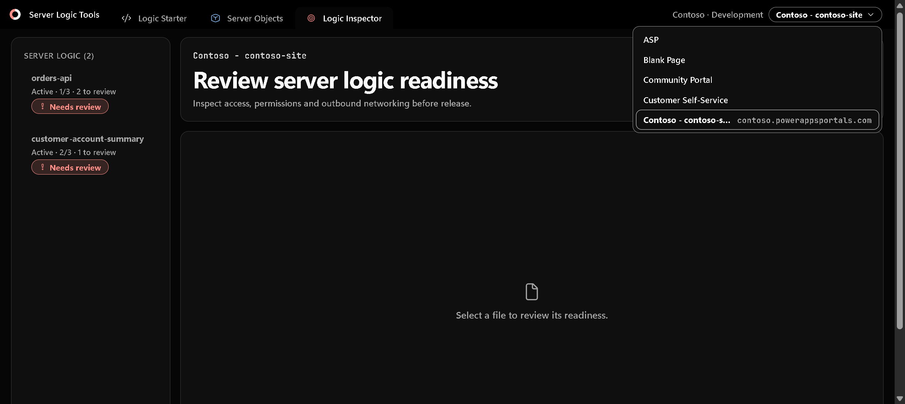
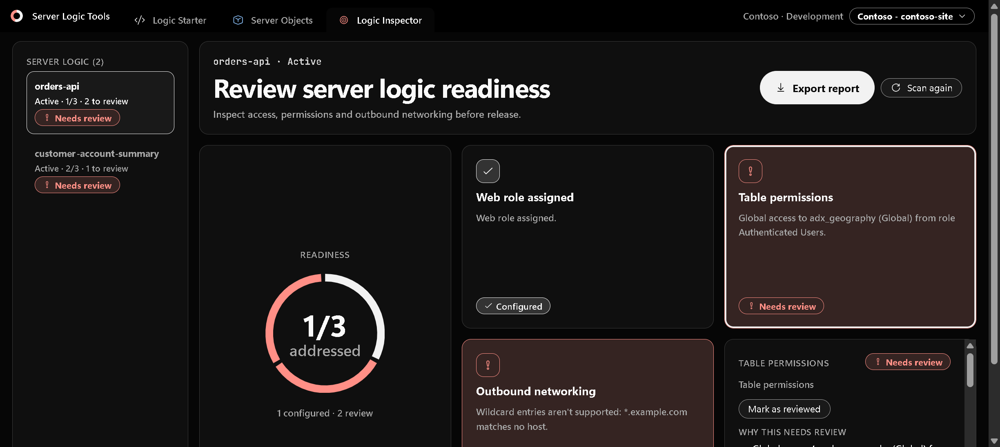
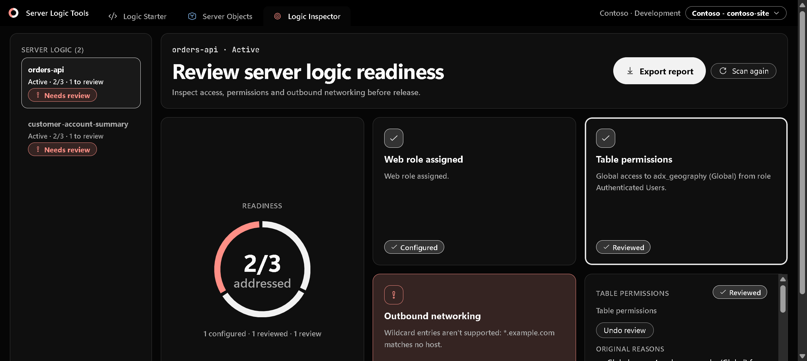
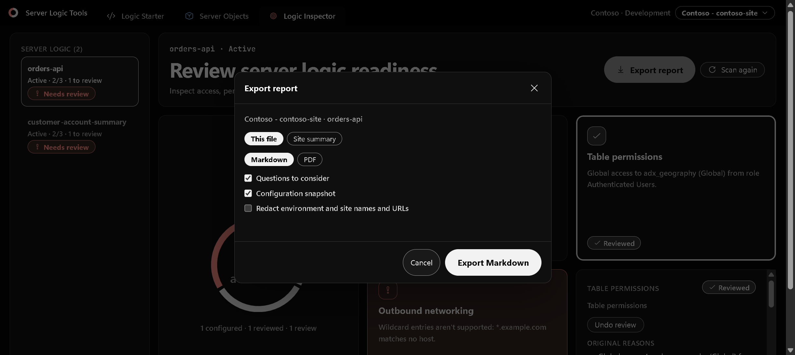

# Inspect a site's server logic

Use **Logic Inspector** to read the server logic files on a Power Pages site and see, for each one, whether its web role, table permissions, and outbound networking look configured, then export the result as a Markdown or PDF report. The Inspector only reads; it never changes your site or environment.

[Back to the user guide](../usage-manual.md) · [Readiness and checks reference](../reference/readiness-and-checks.md)

## Connect and choose a site

1. In PPTB, select one active connection. Until you do, the page reads **No active connection**.
2. Open **Logic Inspector**. It loads the Power Pages sites in the environment. If loading fails, choose **Retry**.
3. Open the site picker in the title bar, which shows **No site selected**, and choose a site. No site is chosen for you, even when the environment has only one. Inactive sites are listed but cannot be chosen.

The Inspector works with enhanced data model sites. If the environment has none, the page says so. If the connection is not a development environment, a notice warns that the Inspector is designed for dev sites; you can still scan.

Environment, site, and server-logic names are illustrative — inactive sites are listed in the picker but shown as disabled.

## Run a scan

Choosing an active site starts its scan. The page shows **Scanning {site}** with a count such as "Scanned 3 of 12" while it reads the server logic records. **Scan again** in the results re-reads the same site.

If the scan fails with an unexpected error, nothing is kept — choose **Scan again**.

## Read the results

- **Server logic** lists every file with its Active or Inactive state, a short summary, and a status of **Ready**, **Needs review**, or **Incomplete**.
- Select a file to see its **Readiness** ring, which counts how many of its three checks are addressed. Configured and reviewed checks both count.
- Each file has three findings: **Web role assigned**, **Table permissions**, and **Outbound networking**. Select one to read its reasons, details, guidance, and questions to consider.
- A finding that needs review can be marked as reviewed with a button in the detail, and the mark can be undone. A review mark applies to your current results only; scanning again clears it.
- Notices above the results explain gaps, such as an incomplete record list, rows the tool could not read, or a lost connection. Some checks show **Not read before the connection was lost**.

The Inspector does not read tenant outbound network policy, does not assess other roles a user may hold, and does not check cloud flows — the page says so where it applies. A **Ready** file means the configuration the tool can see looks complete; it does not prove the handler works or that access is correct. Confirm access with a real site user. The full meaning of each status is in [How readiness is determined](../explanation/how-readiness-is-determined.md).

## Export a report

1. Choose **Export report**. It is disabled when no files were found or read, and the button says why.
2. Choose **This file** (select a file first) or **Site summary**.
3. Choose **Markdown** or **PDF**.
4. Optionally include **Questions to consider** and **Configuration snapshot**, or turn on **Redact environment and site names and URLs**. Redaction replaces the environment's name, URL and host name with `[environment]` and the site's name, URL and host name with `[site]`, in any letter case. Server logic file names are kept, and so are web role and table names, apart from any part that matches the environment or site name.
5. Choose **Export Markdown** or **Export PDF** and pick a location in the PPTB save dialog. Cancelling the dialog saves nothing.

File names follow the pattern `{name}-readiness` for a file report and `{site}-site-readiness` for a site summary, with an `.md` or `.pdf` extension. If the results change while a report is still being built, the export is cancelled and you can start it again.

## If the connection changes mid-scan

If you switch the PPTB connection while a scan is running, the scan is abandoned and its results are discarded; the page shows **The connection changed while scanning**. Choose a site in the title bar to scan again — the earlier scan is not resumed. If the connection is lost during a scan, you get the results read so far with a **Connection lost. Reconnect and rescan.** notice, and you can rescan once the connection is back.

Results are held in memory only. Closing or reloading the tool discards them; export a report to keep them.