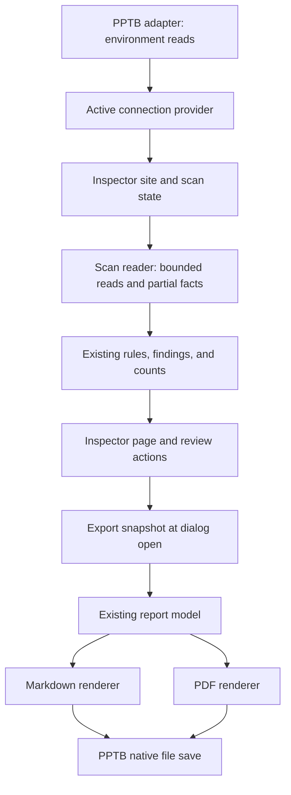

# Server Logic Remaining Work — Initial Design and Plan

**Updated:** October 25, 2026. The filename preserves the originally requested path.

**Status:** Initial design and phased plan, replacing the recovery checkpoint. Detailed implementation steps and acceptance remain open. The user requested this initial document without the formal planning-skill workflow.

**Goal:** Finish Starter behavior coverage, adopt Iris, and deliver the Inspector scan, review page, and Markdown/PDF export flow.

## Starting point

The approved [specification](../specs/001-server-logic-starter-inspector/spec.md) v3.0.0 owns product behavior. The [October 23 status brief](../specs/001-server-logic-starter-inspector/status-2026-10-23.md) distinguishes implemented work from stale checkboxes. The [remaining-work findings](10-24-2026-server-logic-remaining-work-findings.md) preserve corrections F01–F11, applied below.

HEAD `820c313` was verified on October 25. CodeGraph confirmed that `scan.ts`, `renderPdf.ts`, and `InspectorPage.tsx` remain stubs, and that `ConnectionProvider.tsx` clears the connection after a rejected refresh. The existing rules already carry a failed code download into Table permissions and Outbound findings.

The previous planning run recorded passing typecheck, lint, build, and 89 test files / 1,348 tests. These are historical results, not checks rerun for this initial document. Reconfirm its formatting diagnosis before editing configuration. Existing phase plans remain implementation references, subject to the current spec and the corrections here.

## Architecture and ownership

Reuse the existing generators, examples, package generation, Inspector facts/types, rules, grants, setting normalization, counts, report model, escaping, filenames, and Markdown renderer. Keep the PPTB adapter as the environment access boundary and all Inspector state in memory.

Use the installed TypeScript/React, Vitest, CodeMirror, jsPDF, and AutoTable stack. No additional runtime dependency is proposed; PDF still needs its planned bundled JetBrains Mono TTF asset.



| Responsibility | Owner | Boundary |
| --- | --- | --- |
| Active connection refresh | `src/app/ConnectionProvider.tsx` | Keep the last successful value after rejection; accept a successful `null`. |
| Site selection and scan lifetime | Planned `src/app/inspector-site/` | Shared by title-bar picker and page; owns invalidation and scan identity. |
| Reads and partial results | `src/features/inspector/scan/` and PPTB adapter | Convert host evidence into facts; reuse readiness rules. |
| Findings and readiness | Existing `src/features/inspector/model/` | Own Configured, Reviewed, Needs review, Not scanned, and aggregate counts. |
| Inspector presentation | `InspectorPage.tsx` and supporting components | Display results, detail, and review actions. |
| Export lifecycle | Phase 24 dialog and page integration | Own snapshot, options, cancellation, rendering, and save state. |
| Report content | Existing report model | Feed equivalent presentation data to Markdown and PDF. |
| UI appearance | `src/app/theme/tokens.css` and existing UI styles | Use Iris; report appearance retains its separate contract. |

### Connection and scan lifecycle

Refresh the active connection on host connection events, window focus, and visible-document changes. Compare the returned id and URL rather than reading event payload fields. Retain results and review marks when identity is unchanged, including after transient refresh rejection. A successful refresh can still update labels and environment warnings.

A real identity change, successful `null`, different site, or rescan invalidates the old scan and review marks. Reject asynchronous completions belonging to superseded scans. Preserve the provider's latest-request guard and clean up subscriptions and listeners.

Run reads through the adapter's paging and bounded retry with at most four reads in flight. Keep facts already read when a network failure or 401 stops a scan with unchanged connection identity. Unread checks become Not scanned, and partial inventory stays explicitly incomplete. A 403 affects the relevant checks as a read failure.

Preserve explicit `HostReadError.transport` evidence. An absent HTTP status, unexpected response shape, or unclassified host exception does not alone prove connection loss. Live network-error mappings still need S2 evidence.

The handler-byte limitation does not block implementation: use the existing couldn't-read-handler-code outcome. Configuration reads continue, but Table permissions and Outbound stay Needs review and cannot be marked Reviewed when they contain that read failure. An empty JSON object is not usable handler code. Keep environment access within the approved read-only adapter contract.

### Review and export lifecycle

The page owns site selection, scan progress, files, banners, findings, detail, and review actions. Empty, failed, and incomplete results stay distinct. Configured and Reviewed stay distinct, and reviewed findings retain their original reasons. Results and review marks are never persisted.

Phase 23 must compile independently: it supplies export eligibility. Phase 24 introduces the dialog imports, snapshot state, and save lifecycle, so the page never depends on files that have not yet been implemented.

Allow export after a finished or stopped scan with at least one discovered file. Capture the snapshot when the dialog opens. Default to Markdown and the selected file, or Site summary without a selected file. Clearing results before native save cancels the pending export. Once native save starts, keep its submitted snapshot. Wire `onSaveFailed` to reset `saving` so rejected saves restore usable controls.

Markdown and PDF must convey the same findings, reviewed reasons, notices, redaction choices, and scan interval. Reuse the existing report model instead of rebuilding content in the dialog or PDF renderer.

### Visual design

Apply Iris before the Inspector page so new styles use Iris names directly. Layout and behavior continue to follow layout 10a. Use dark code wells in both themes, Segoe UI at 550/650, and JetBrains Mono with an explicit 400 weight for code. Replace aurora/glass with the approved corner glows; theme remains host-driven.

Rename the current content-area `--surface` to `--bg2` before mapping tile color to Iris `--surface`. Keep CSS component class names. Preserve report colors/fonts under their existing contract and keep generated demo-page CSS separate from the application theme migration.

## Delivery sequence

1. Restore the formatting gate.
2. Build the Starter behavior harness, then complete R7 behavior coverage.
3. Apply Iris.
4. Implement the Inspector scan reader.
5. Complete PDF rendering.
6. Build the Inspector page, after Iris and the scan reader.
7. Add export dialog integration, after the page and PDF.
8. Reconcile documentation and complete integration and owner acceptance.

Starter coverage, Iris, the scan reader, and PDF have largely separate ownership. This sequence works without parallel agents. If work is later split, keep shared adapter/connection edits coordinated and finish Iris before page styling.

## Work packages

### 1. Restore the formatting gate

**Owns:** `.prettierignore`, `.prettierrc.json`; F10.

Reconfirm the recorded cause: scratch files enter the global check, and working-tree CRLF differs from Prettier's default line-ending policy. The proposed fix is to ignore `.scratch` and set `endOfLine: "auto"`, preserving LF attributes for generated/report fixtures.

**Done when:** `npm run format:check` passes without rewriting unrelated files. If the diagnosis has drifted, record remaining failures before widening the change.

### 2. Prove Starter and R7 behavior

**Owns:** generator/client/demo test support and behavior tests; F01–F02. Production changes address defects exposed by this coverage.

Use [Phase 17](../specs/001-server-logic-starter-inspector/plans/phase-17-behavior-harness.md) as the coverage outline. Build a test-only generated-handler harness with a fake `Server`, synchronous Dataverse methods, asynchronous HTTP/cloud-flow methods, recorded calls, and controlled outcomes. Cover all 36 client configurations immediately. R7 exists; remove obsolete `PENDING_R7` and generator-throws assumptions.

Cover handler success, connector failures, empty bodies, input validation, missing settings, and sentinel-secret handling. Execute fetch/jQuery failure paths, supported Liquid output, and R4/R5/R6 demo-page behavior. Assert request shapes and a single reported outcome as well as generated text.

Resume [Phase 19](../specs/001-server-logic-starter-inspector/plans/phase-19-handler-r7.md) at its remaining R7 coverage: stage failures, secret leakage, hostile names, and retry/collision consequences. Check package/README coverage before adding work there; retain the existing handler, goldens, and S3 script.

**Done when:** all 36 configurations and required handler/demo failure paths are covered without R7 exclusions. The owner-run S3 collision probe remains a separate gate.

### 3. Apply Iris across the UI

**Owns:** theme tokens/tests, primitive/shell styles, Starter/code styles, Server Objects styles, and Tile description.

Follow [Phase 25](../specs/001-server-logic-starter-inspector/plans/phase-25-iris-theme.md) with the visual boundaries above. Migrate tokens and consumers coherently. Preserve layout, interactions, accessibility, report formatting, and generated output.

**Done when:** token/contrast and component checks pass; both themes have approved code wells, highlights, and typography; obsolete glass/aurora styles are removed. Rendered comparison and PPTB glow contrast still require acceptance evidence.

### 4. Implement the scan reader

**Owns:** `src/features/inspector/scan/`, scan fixtures, and necessary PPTB error/download adapter changes; F03–F05.

Complete [Phase 15](../specs/001-server-logic-starter-inspector/plans/phase-15-inspector-scan.md) using the existing facts/rule contracts. Include site listing, deterministic paging, escaped filters, bounded concurrency, progress, partial inventory, and stale-result handling. Apply the error-classification and unreadable-code corrections above.

**Done when:** fixtures prove full/partial scans, the four-read limit, stale-result rejection, 401/explicit-transport stopping, 403/non-transport failures, and unreadable code that cannot produce a Ready file. Live paging and scan timing remain separate.

### 5. Complete PDF rendering

**Owns:** `src/features/inspector/report/renderPdf.ts`, PDF-specific helpers/tests, and bundled font asset; F03/F09.

Complete [Phase 20](../specs/001-server-logic-starter-inspector/plans/phase-20-report-pdf.md) using the existing report model. Preserve report styling, wrapping, pagination, redaction, and metadata. Bundle the planned fonts including JetBrains Mono TTF, and draw the check mark as a vector glyph.

**Done when:** both report scopes handle long/hostile text, reviewed reasons, partial results, banners, pagination, and font coverage. Existing Markdown/report-model checks pass; native save is verified separately.

### 6. Build the page and connection lifecycle

**Owns:** `ConnectionProvider.tsx` and tests; planned `src/app/inspector-site/`; site pill; Inspector components/styles; build-shape integration; F06–F07.

Complete [Phase 23](../specs/001-server-logic-starter-inspector/plans/phase-23-inspector-page.md) with existing findings/counts. Include the shared title-bar picker, no automatic site selection, inactive-site handling, warnings, progress, results, detail, review/undo, and error/empty states. Apply connection retention, focus/visibility refresh, and cleanup here.

Use Iris names. Limit export integration to eligibility until work package 7. Update the build-shape marker before the page's checks; keep Inspector provider/picker code behind the existing page-release boundary.

**Done when:** the page compiles independently; transient refresh failure preserves findings/review marks; real context changes clear them; superseded scans cannot repaint; builds excluding Inspector exclude its implementation. Check keyboard/focus and rendered states alongside automated behavior.

### 7. Integrate the export dialog

**Owns:** Phase 24 dialog/lifecycle modules, page integration, and tests; F08.

Complete [Phase 24](../specs/001-server-logic-starter-inspector/plans/phase-24-export-dialog.md) with the snapshot/cancellation design above. Wire both `onSaving` and `onSaveFailed`. Reuse filenames, report content, renderers, and notifications. Include focus trapping, Escape, and focus return.

**Done when:** both scopes/formats, defaults, and redaction work; cleared results cancel before native save; an in-flight save retains its snapshot; rejection restores controls; failures produce no success notification. Measure report construction separately from save timing.

### 8. Reconcile documentation and finish acceptance

**Owns:** plan/status documentation, probe evidence reconciliation, and remaining page gates; F11.

Update stale phase/index status from implementation evidence. Carry forward accepted S2 clipboard and binary-save evidence. Clarify that handler-byte limitations affect findings but do not block Phase 15. Keep unverified paging/error shapes and `NEXT_LINK_UNVERIFIED` visible until live evidence resolves them.

After implementation, run the existing checks sequentially and record actual results:

```powershell
npm run typecheck
npm run lint
npm run format:check
npm test
npm run build
```

Verify the single-IIFE build and page exclusion rules, including that Server Objects cannot ship without Starter. Validate the manifest during release preparation. Local tests and browser fakes do not establish PPTB/Dataverse acceptance.

**Done when:** implementation status matches evidence and every owner gate below has a result or remains explicitly open. Publishing requires separate owner authorization for each release.

## Owner acceptance and unresolved evidence

| Gate | Evidence still needed | Effect |
| --- | --- | --- |
| S2 follow-up | Paging token and quote/space wire requests; event arguments/unsubscribe; populated-file metadata; environment-variable row counts; host/runtime version; network-drop and expired-sign-in shapes | Refines host compatibility and error mapping. Scan implementation can use the unreadable-code fallback. |
| S3 collision probe | Exact Graph upload path rejects an existing ticket/file instead of overwriting it | R7 overwrite prevention remains unverified until this passes. |
| R4 bound create | Caller account can be bound during a live create | Keep approved Global Create-only guidance until a passing probe and spec update. |
| Starter | PPTB smoke, both-theme glow contrast, three-maker walkthrough with median at most five minutes | Required for Starter release. |
| Server Objects | PPTB/theme checks and rendered layout at 1100×780 | Release with or after Starter. |
| Inspector | Dev-site scan of up to 50 records within 30 seconds; both exports compared with screen; theme/accessibility and save checks | Required for Inspector release. Report build and save budgets are each five seconds under the spec. |

## Boundaries and next step

No additional product decision is required for this initial design. Remaining unknowns concern host/runtime evidence and implementation detail within the approved spec. A contradictory host result calls for a focused spec decision before changing that behavior.

Preserve unrelated staged, dirty, deleted, and untracked work, including `.codegraph/`, design inputs, scratch work, and local tool configuration. This planning pass changes only this document and performs no application implementation, commits, pushes, or environment changes.

Begin implementation with work package 1, then Starter behavior coverage. Use the cited phase plans for detail, applying this document's corrections before their older instructions.
